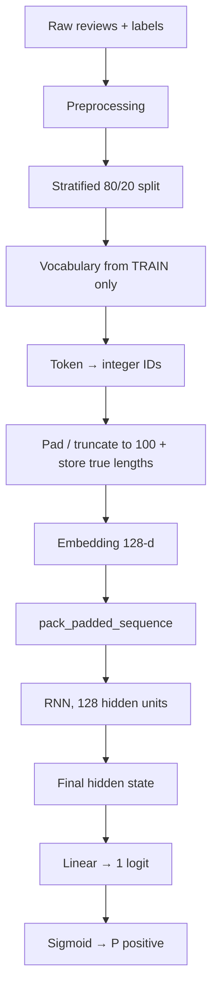
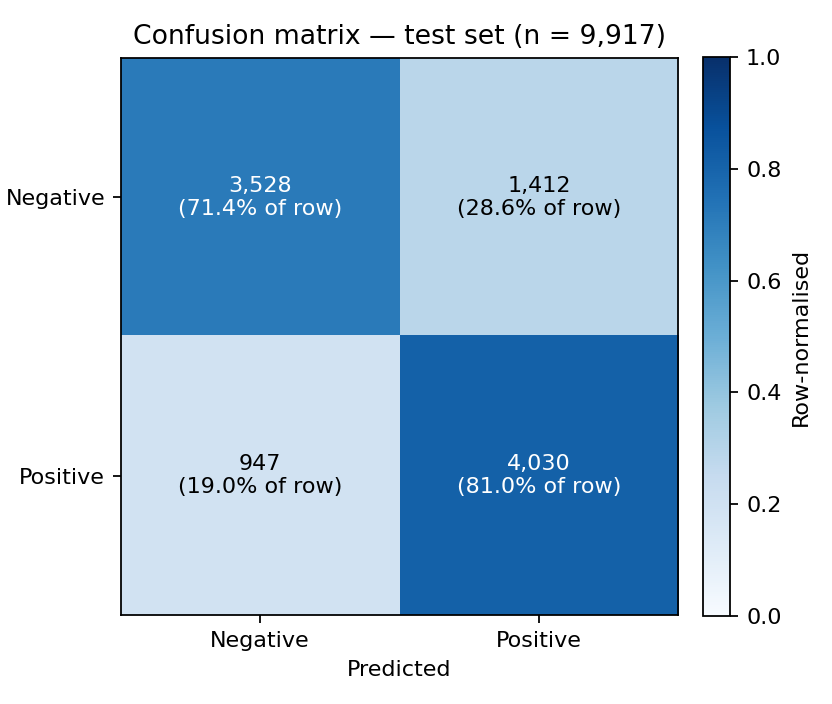
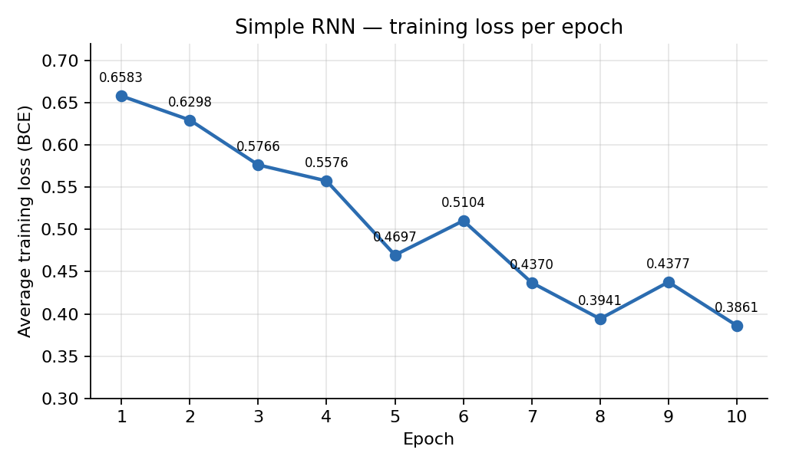

# Sentiment Analysis of Movie Reviews with a Simple Recurrent Neural Network

**A PyTorch baseline for binary sentiment classification**

| | |
|---|---|
| **Author** | <Your Name> |
| **Date** | October 2026 |
| **Code** | `https://github.com/yashpal0502/rnn-sentiment-analysis.git` |
| **Version** | 1.0 — baseline Simple RNN |

---

## Table of Contents

1. [Abstract](#abstract)
2. [Introduction](#1-introduction)
3. [Background](#2-background)
4. [Dataset](#3-dataset)
5. [Methodology](#4-methodology)
6. [Experimental Setup](#5-experimental-setup)
7. [Results](#6-results)
8. [Discussion](#7-discussion)
9. [Limitations and Threats to Validity](#8-limitations-and-threats-to-validity)
10. [Future Work](#9-future-work)
11. [Conclusion](#10-conclusion)
12. [Appendix](#appendix)

---

## Abstract

This report documents an end-to-end binary sentiment classifier for movie reviews built around a Simple (Elman) Recurrent Neural Network in PyTorch. The pipeline covers negation-aware text preprocessing, a stratified 80/20 train/test split, a training-only vocabulary, integer encoding with padding and truncation, a learned 128-dimensional embedding layer, a single-layer RNN fed with packed variable-length sequences, and a one-logit output trained with `BCEWithLogitsLoss` and Adam.

On a held-out test set of 9,917 reviews the model reaches **76.21% accuracy** (95% CI ≈ ±0.84 percentage points), with **precision 0.7405, recall 0.8097 and F1 0.7736** for the positive class. The model is biased toward predicting *Positive* (recall 81.0% vs. specificity 71.4%). An earlier TF-IDF-based, single-time-step RNN reached ≈ 84.21%, so the current sequence model is *behind* that baseline; the report discusses plausible reasons and the experiments needed to test them. The trained weights were saved, reloaded in a separate notebook, and used for inference on unseen reviews.

The project is intended as a reproducible reference point for later comparisons with Bidirectional RNN, LSTM and GRU models.

---

## 1. Introduction

### 1.1 Motivation

Sentiment analysis — determining the polarity of a piece of text — is a core NLP task with applications in review mining, brand monitoring and customer feedback. Bag-of-words representations such as TF-IDF capture word statistics but discard word order, so "not good" and "good, not bad" can look similar. A recurrent network reads tokens one at a time and carries a hidden state forward, which makes it a natural first model for studying order-dependent text.

### 1.2 Problem statement

Given a movie review $x$, estimate its sentiment label $y \in \{0, 1\}$ (`0` = Negative, `1` = Positive) by modelling

$$P(y = 1 \mid x).$$

### 1.3 Objectives

1. Clean raw review text while preserving sentiment-critical negations.
2. Split the data without leaking test information into the vocabulary.
3. Encode reviews as fixed-length integer sequences and learn word embeddings.
4. Build, train and evaluate a Simple RNN classifier.
5. Persist the model and use it for inference on new reviews.
6. Establish a well-documented baseline for LSTM / GRU / Bidirectional experiments.

### 1.4 Contributions

- A clean, leak-aware sequence-classification pipeline implemented end to end.
- Correct handling of variable-length input using packed sequences.
- A transparent baseline report, including an honest comparison to an earlier TF-IDF model and an explicit list of limitations.

---

## 2. Background

**Recurrent neural networks.** A Simple RNN (Elman, 1990) maintains a hidden state $h_t$ updated at each time step from the current input $x_t$ and the previous state:

$$h_t = \tanh\left(W_{xh}\,x_t + W_{hh}\,h_{t-1} + b_h\right)$$

**Long-range dependencies.** Gradients propagated through many time steps tend to vanish or explode (Bengio et al., 1994), which makes plain RNNs weak at remembering information from early in a sequence. LSTM (Hochreiter & Schmidhuber, 1997) and GRU (Cho et al., 2014) add gating to mitigate this and are the planned next steps.

**Word embeddings.** Instead of sparse one-hot or TF-IDF vectors, each token ID is mapped to a dense, trainable vector. Here the embeddings are learned from scratch together with the classifier.

**Sentiment classification.** Machine-learning approaches to review polarity date back to at least Pang et al. (2002); the movie-review domain remains a standard benchmark.

---

## 3. Dataset

| Property | Value |
|---|---|
| Total reviews (after processing) | **49,582** |
| Task | Binary: Negative (0) / Positive (1) |
| Split | Stratified 80/20, `random_state=42` |
| Training set | **39,665** reviews |
| Test set | **9,917** reviews |
| Test class balance | 4,940 Negative (49.8%) / 4,977 Positive (50.2%) |
| Validation set | None (see [Limitations](#8-limitations-and-threats-to-validity)) |

The class balance is derived from the test-set confusion matrix; stratification means the training set has the same proportions, so **accuracy is a meaningful metric** and no re-weighting is needed.

**Provenance.** The project materials do not record the dataset source. The size (49,582) and the near-perfect class balance are consistent with the widely used IMDB 50K movie-review dataset (Maas et al., 2011) after removing duplicate reviews, but this has **not been verified** and should be confirmed — together with the licence — before publication.

---

## 4. Methodology

### 4.1 Pipeline overview



### 4.2 Preprocessing

Applied in this order:

1. Lowercasing
2. URL removal
3. HTML-tag removal
4. Punctuation removal
5. Tokenization
6. Stopword removal — **except** negations
7. Porter stemming (Porter, 1980)

Negation words (`not`, `no`, `nor`, `never`, `neither`, `n't`) are preserved because dropping them can invert the meaning of a sentence ("not good" → "good"). All of these steps are stateless, so applying them before the split does not leak information.

### 4.3 Train/test split

```python
train_test_split(..., test_size=0.2, random_state=42, stratify=labels)
```

### 4.4 Vocabulary and encoding

- The vocabulary is built from **training reviews only**, so no test-set token statistics influence the representation.
- Reserved tokens: `<PAD> = 0`, `<UNK> = 1`.
- Size: **124,455** tokens.
- Tokens not seen in training (including at inference time) map to `<UNK>`.

### 4.5 Padding, truncation and sequence lengths

Every review is padded with `<PAD>` or truncated to **100 tokens**. The true (post-truncation) length is stored alongside each sequence so padding can be ignored by the recurrent layer.

### 4.6 Embedding layer

`nn.Embedding(124455, 128, padding_idx=0)` maps a batch of IDs $(B, T)$ to dense vectors $(B, T, 128)$. For a batch of 64 and $T = 100$: `[64, 100] → [64, 100, 128]`. The padding vector is fixed at zero and receives no gradient.

### 4.7 Model architecture

```text
Token IDs  [B, 100]
   ↓  Embedding(124 455 → 128, padding_idx = 0)
[B, 100, 128]
   ↓  pack_padded_sequence(lengths, enforce_sorted = False)
   ↓  RNN(input = 128, hidden = 128, layers = 1, tanh)
Final hidden state  [B, 128]
   ↓  Linear(128 → 1)
Logit  [B]
```

Reference implementation of the described architecture:

```python
import torch.nn as nn
from torch.nn.utils.rnn import pack_padded_sequence

class SentimentRNN(nn.Module):
    def __init__(self, vocab_size=124_455, embed_dim=128, hidden_dim=128):
        super().__init__()
        self.embedding = nn.Embedding(vocab_size, embed_dim, padding_idx=0)
        self.rnn = nn.RNN(embed_dim, hidden_dim, batch_first=True)
        self.fc = nn.Linear(hidden_dim, 1)

    def forward(self, x, lengths):
        emb = self.embedding(x)                                   # (B, T, 128)
        packed = pack_padded_sequence(emb, lengths.cpu(),
                                      batch_first=True,
                                      enforce_sorted=False)
        _, h_n = self.rnn(packed)                                 # h_n: (1, B, 128)
        return self.fc(h_n[-1]).squeeze(1)                        # (B,) logits
```

> The snippet mirrors the architecture documented here; the authoritative version is in `src/05_rnn_model.ipynb`.

**Why packed sequences?** Padding makes batches rectangular but its tokens are not words. Packing lets the RNN stop at each review's real length, so the final hidden state summarises the actual text rather than trailing padding.

**Parameter count (computed from the configuration):**

| Component | Parameters |
|---|---:|
| Embedding (124,455 × 128) | 15,930,240 |
| RNN (input→hidden 128×128, hidden→hidden 128×128, two bias vectors) | 33,024 |
| Linear (128 + 1) | 129 |
| **Total** | **≈ 15,963,393** |

About **99.8%** of the parameters sit in the embedding table, which is relevant for overfitting (see [Discussion](#7-discussion)).

### 4.8 Output and decision rule

The final hidden state $h_T$ is mapped to a logit and converted to a probability:

$$z = W h_T + b, \qquad p = \sigma(z) = \frac{1}{1 + e^{-z}}$$

$$\hat{y} = \begin{cases} 1\ (\text{Positive}) & p \ge 0.5 \\ 0\ (\text{Negative}) & p < 0.5 \end{cases}$$

### 4.9 Loss and optimisation

Binary cross-entropy:

$$L = -\big[\,y \log p + (1 - y)\log(1 - p)\,\big]$$

`nn.BCEWithLogitsLoss()` fuses the sigmoid and the cross-entropy in a numerically stable way, so the network outputs raw logits. Parameters are optimised with Adam (Kingma & Ba, 2015). Each iteration performs: zero gradients → forward pass → loss → backward pass → optimizer step.

### 4.10 Evaluation metrics

With $TP, TN, FP, FN$ taken from the confusion matrix:

$$\text{Accuracy} = \frac{TP + TN}{TP + TN + FP + FN}, \qquad \text{Precision} = \frac{TP}{TP + FP}$$

$$\text{Recall} = \frac{TP}{TP + FN}, \qquad F_1 = 2\cdot\frac{\text{Precision}\cdot\text{Recall}}{\text{Precision}+\text{Recall}}$$

Precision, recall and F1 are reported for the **positive class**; per-class and macro values are given in [Section 6.2](#62-per-class-metrics).

### 4.11 Model persistence

Only the `state_dict` is saved to `models/sentiment_rnn.pth`. To reload, the identical architecture (same vocabulary size and layer widths) must be constructed first, then `load_state_dict` is called. Inference reuses the **training** vocabulary stored in `data/rnn_data.pt`.

---

## 5. Experimental Setup

### 5.1 Hyperparameters

| Parameter | Value |
|---|---|
| Epochs | 10 |
| Batch size | 64 |
| Embedding dimension | 128 |
| Hidden size | 128 |
| RNN layers | 1 |
| Max sequence length | 100 |
| Vocabulary size | 124,455 |
| Optimizer | Adam |
| Learning rate | 0.001 |
| Loss | `BCEWithLogitsLoss` |
| Dropout / weight decay / gradient clipping | None |
| Early stopping / LR schedule | None |

### 5.2 Software and hardware

| Item | Value |
|---|---|
| Python, PyTorch, scikit-learn, NLTK versions | *Not recorded — add before publishing* |
| Hardware (CPU / GPU) | *Not recorded* |
| Total training time | *Not recorded* |
| PyTorch random seed | *Not recorded* (only the data split is seeded with 42) |

Libraries used: Python, PyTorch (Paszke et al., 2019), pandas, NumPy, scikit-learn, NLTK, Matplotlib, Seaborn, Jupyter.

---

## 6. Results

### 6.1 Headline test-set metrics

| Metric | Score |
|---|---:|
| **Accuracy** | **76.21%** |
| **Precision** (positive) | **0.7405** |
| **Recall** (positive) | **0.8097** |
| **F1** (positive) | **0.7736** |

A normal-approximation 95% confidence interval for accuracy on 9,917 test reviews is **±0.84 percentage points** (≈ 75.4% – 77.0%).

### 6.2 Per-class metrics

Derived from the confusion matrix:

| Class | Precision | Recall | F1 | Support |
|---|---:|---:|---:|---:|
| Negative | 0.7884 | 0.7142 | 0.7494 | 4,940 |
| Positive | 0.7405 | 0.8097 | 0.7736 | 4,977 |
| **Macro average** | 0.7645 | 0.7619 | 0.7615 | 9,917 |

### 6.3 Confusion matrix



| | Predicted Negative | Predicted Positive |
|---|---:|---:|
| **Actual Negative** | TN = 3,528 | FP = 1,412 |
| **Actual Positive** | FN = 947 | TP = 4,030 |

The model predicts *Positive* 5,442 times although only 4,977 reviews are positive (+9.3%). False positives (1,412) outnumber false negatives (947) by about 1.5 to 1.

### 6.4 Training behaviour



| Epoch | Avg. training loss |
|---:|---:|
| 1 | 0.6583 |
| 2 | 0.6298 |
| 3 | 0.5766 |
| 4 | 0.5576 |
| 5 | 0.4697 |
| 6 | 0.5104 |
| 7 | 0.4370 |
| 8 | 0.3941 |
| 9 | 0.4377 |
| 10 | 0.3861 |

Loss falls from 0.658 to 0.386 overall, with temporary increases at epochs 6 and 9. Small non-monotonic movements are common with mini-batch Adam, and they are typical of plain RNNs, whose gradients can be unstable.

### 6.5 Qualitative inference

The saved model was reloaded in a separate notebook and applied to hand-written reviews. The probability is the estimated **positive-class probability for that review**, not overall accuracy.

| Review | Prediction | P(positive) |
|---|---|---:|
| Amazing acting and a great story. | Positive | 0.9850 |
| This movie was absolutely amazing. I really loved it! | Positive | 0.9427 |
| This movie was fantastic. I loved every minute of it! | Positive | 0.9218 |
| I did not enjoy this movie at all. | Negative | 0.1886 |
| I really hated this movie. | Negative | 0.1356 |
| This was the worst movie I have ever watched. | Negative | 0.0258 |
| The movie was okay, nothing special. | Negative | 0.0124 |

These seven examples are hand-picked and **anecdotal**; they illustrate behaviour but are not evidence of accuracy.

### 6.6 Comparison with the earlier TF-IDF baseline

| Model | Input representation | Test accuracy |
|---|---|---:|
| TF-IDF → single time step → RNN (earlier) | Sparse document vector | ≈ 84.21% |
| **Embedding → sequence → Simple RNN (this work)** | Learned embeddings over token sequence | **76.21%** |

The two models differ in features, input shape and preprocessing path, so this is a comparison of *pipelines*, not a controlled architecture comparison.

---

## 7. Discussion

**Overall performance.** 76.21% accuracy is a functional baseline but not strong for this kind of task. The difference to the TF-IDF model (≈ 8.0 points) is roughly ten times the ±0.84-point confidence interval, so it is unlikely to be noise.

**Why might the sequence RNN trail TF-IDF?** The following are *hypotheses* to be tested, not established findings:

1. **Over-parameterised embeddings.** 15.9 M of the 16.0 M parameters are embeddings learned from ~40k reviews with a 124k-token vocabulary, so many rare-word vectors are barely trained. A frequency cut-off or pre-trained embeddings (GloVe / fastText) would test this.
2. **Vanishing gradients and last-state summarisation.** A Simple RNN must squeeze up to 100 tokens into one 128-d vector; sentiment cues far from the end may be lost. LSTM / GRU, bidirectionality, or mean/max pooling over all hidden states would test this.
3. **Truncation.** Any review longer than 100 tokens loses text, whereas TF-IDF sees the whole document.
4. **No regularisation or tuning.** There is no dropout, no weight decay, no gradient clipping and no hyperparameter search.

**Positive-class bias.** Recall is 0.81 for Positive but only 0.71 for Negative. Possible contributors include the default 0.5 threshold, uncalibrated probabilities, and positive vocabulary being easier to separate after stemming and stopword removal. Threshold analysis, a ROC/PR curve and a calibration plot would clarify this; none were computed.

**Generalisation gap is unmeasured.** Only average *training loss* was logged. Training accuracy and any validation metric were not recorded, so it is not possible to say how much of the performance gap is overfitting versus underfitting. Logging per-epoch train and validation accuracy is the most informative next step.

**Behaviour on negation and neutrality.** In the small qualitative sample, a negated positive ("did not enjoy") was handled correctly, which is consistent with preserving negations during preprocessing. "Okay, nothing special" received P(positive) = 0.012 — a *very confident* Negative for a lukewarm review, which highlights that the binary label space (and possibly the training data's labelling) leaves no room for neutral sentiment.

---

## 8. Limitations and Threats to Validity

**Modelling**
- Simple RNN with a single layer, unidirectional, final-state classification.
- Fixed 100-token window; longer reviews are truncated.
- Binary classification only; no neutral class.

**Experimental design**
- **No validation set.** If the epoch count or any other choice was influenced by test performance, the reported 76.21% is optimistic.
- **Single training run.** Variance across random seeds is unknown; the 95% CI above reflects only test-sample size, not training randomness.
- **No systematic tuning** of any hyperparameter.
- Training accuracy, ROC-AUC and calibration were not measured.

**Data**
- Dataset provenance and licence are undocumented (see [Section 3](#3-dataset)).
- Reviews are from one domain (movies); results may not transfer to other text types.
- Label noise and near-duplicate reviews, if present, were not audited.

**Preprocessing — to verify**
- If punctuation (including apostrophes) is removed *before* tokenization, contractions such as "don't" may become "dont", in which case the `n't` token would never appear and that negation would not be preserved as intended. This should be checked on real examples.
- Stemming and aggressive stopword removal are not necessarily optimal for neural models, which can learn from raw or lightly processed tokens.

---

## 9. Future Work

| Priority | Item | Purpose |
|---:|---|---|
| 1 | Add train / validation / test split; log train & validation accuracy each epoch | Enable honest tuning and early stopping |
| 2 | Hyperparameter search (hidden size, embedding size, LR, max length, vocab cut-off) | Improve the baseline fairly |
| 3 | Dropout, weight decay, gradient clipping | Reduce overfitting and loss instability |
| 4 | Bidirectional RNN, **LSTM**, **GRU** under identical protocol | Core planned comparison |
| 5 | Pre-trained embeddings (GloVe / fastText) | Address under-trained embeddings |
| 6 | Pooling over all hidden states / attention | Reduce reliance on the last state |
| 7 | Error analysis of the 2,359 misclassified reviews; threshold, ROC-AUC and calibration analysis | Understand the positive bias |
| 8 | Multiple seeds, report mean ± std | Quantify training variance |
| 9 | Preprocessing audit and ablation (with / without stemming and stopword removal) | Check the `n't` issue and the value of each step |
| 10 | Standalone `predict.py` / REST API | Deployable inference |

---

## 10. Conclusion

This project delivers a complete, leak-aware sentiment-analysis pipeline — from raw text through preprocessing, a training-only vocabulary, integer sequences, embeddings and a packed-sequence Simple RNN, to evaluation, model persistence and real-review inference. The baseline reaches **76.21% test accuracy (F1 = 0.7736)** with a noticeable bias toward the Positive class, and it currently underperforms an earlier TF-IDF model (≈ 84.21%).

Its main value is as a transparent starting point. The next steps — a validation set, systematic tuning, regularisation, and LSTM / GRU / Bidirectional variants evaluated under the same protocol — will show how much of the gap is due to the architecture and how much to the untuned setup.

---

## Appendix

### A.1 Repository map

| Path | Role |
|---|---|
| `src/01_preprocessing.ipynb` | Text cleaning → `data/processed_reviews.csv` |
| `src/02_dataset_dataloader.ipynb` | Earlier TF-IDF dataset / DataLoader stage |
| `src/03_build_rnn.ipynb` | Earlier RNN on TF-IDF input |
| `src/04_rnn_preparation.ipynb` | Split, vocabulary, encoding, padding, tensors → `data/rnn_data.pt` |
| `src/05_rnn_model.ipynb` | Final sequence RNN: training, evaluation, saving |
| `src/06_prediction.ipynb` | Loads the model + vocabulary; predicts new reviews |
| `models/sentiment_rnn.pth` | Trained `state_dict` |

### A.2 Glossary

| Term | Meaning |
|---|---|
| **Logit** | Raw, unbounded model output before the sigmoid |
| **Hidden state** | The RNN's running memory vector $h_t$ |
| **Padding / `<PAD>`** | Filler token that makes sequences equal length |
| **`<UNK>`** | Placeholder for words not in the vocabulary |
| **Packed sequence** | PyTorch structure that lets an RNN skip padding |
| **Stratified split** | Split that preserves class proportions in both sets |
| **Specificity** | Recall of the Negative class, $TN/(TN+FP)$ |
| **Macro average** | Unweighted mean of per-class scores |

### A.3 Reproducibility checklist

- [x] Fixed data split (`random_state=42`, stratified)
- [x] Vocabulary built from training data only
- [x] Hyperparameters documented
- [x] Trained weights and vocabulary saved
- [ ] PyTorch / NumPy random seed set and recorded
- [ ] Library versions pinned (`requirements.txt` with versions)
- [ ] Hardware and training time recorded
- [ ] Dataset source, version and licence recorded
- [ ] Results repeated over multiple seeds
- [ ] Train / validation / test split used for model selection
